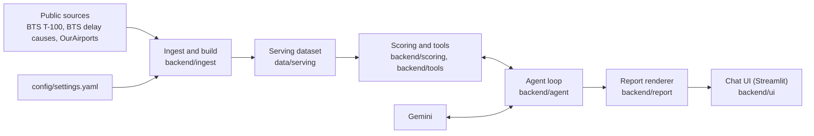

# Airport investment agent: design

## 1. Overview
A chat agent that helps analysts find US airports where terminal renovation or expansion is likely to pay off. The thesis is that renovation pays where added capacity would be filled:
- **Passenger side**: demand is growing and planes are full.
- **Flight side**: flights are growing and the airport is congested.

A capacity-need score ranks the covered airports on both sides. It is a proxy for profit, not a financial return.

The core rule: **the language model never computes a number.** Deterministic code over public data computes every figure, the model picks tools and writes short prose, and code checks each number in that prose before it is shown.

## 2. Architecture

- **Data**:
  - Sources:
    - BTS T-100 airport-month traffic (data.bts.gov API, from 2019-01);
    - BTS delay causes (from 2024-01);
    - BTS T-100 segment data for route distances;
    - OurAirports for names and runways.
  - The build joins them and runs checks: duplicate keys, named airports present, totals reconcile. It replaces the serving data only if every check passes.
  - Current window: 2025-08 to 2026-07.
  - Covered airports: 180 US airports with at least 250,000 passengers in the window; 178 of them have delay data.
- **Tools**:
  - five read-only data tools: `resolve_airport`, `rank_airports`, `compare_airports`, `airport_profile`, `airport_trend`;
  - `faa_airport_status`, which reads the live FAA status feed;
  - `check_data_updates` and `refresh_data`, which call BTS at question time.

  A refresh runs only when the user asks, builds in a temporary folder, and swaps the data in only when the checks pass and a newer month exists. Every tool returns the same envelope: result, definitions, warnings, data quality and data periods.
- **Agent loop**: a small hand-written loop around Gemini (`gemini-3.8-flash` by default). It allows up to 7 tool rounds per question, then runs the number check and saves the turn.
- **Report**: code renders the tables and fixed sections; the model writes only the Verdict and Why, plus a Comparison for investment questions.
- **Chat UI**: a local Streamlit app with conversations, follow-up buttons, voice questions (transcribed by Gemini) and a Listen button that reads the answer aloud.

## 3. Scoring methodology

| Side | Component | Raw metric (12-month window) | Weight |
|---|---|---|---|
| Passenger | passenger growth | compound annual passenger growth since 2019 | 0.25 |
| Passenger | load factor | passengers / seats | 0.25 |
| Flight | flight growth | compound annual departures growth since 2019 | 0.25 |
| Flight | congestion | arrival system-delay (NAS) rate | 0.25 |

**Score**
- Each metric becomes a national rank percentile across the 180 airports. Percentiles resist outliers and make different units comparable.
- The total score (0 to 100) is the weighted sum of the four percentiles. The passenger and flight scores show which kind of capacity is under pressure.
- Rates come from counts summed over the window. All weights and thresholds live in `config/settings.yaml`.

**Missing data is never imputed.** An airport missing a component gets a partial score that is never labeled or compared with full scores. In this build that applies to DJT and HVN, which have no delay data.

**Label** (fixed rules in code; the model only quotes it)
- **Potential**: high at a score of 65 or more, medium from 50, low below 50.
- **Confidence**: high with full data, medium with a cargo-heavy warning.

| Potential | High confidence | Medium confidence |
|---|---|---|
| High | Prioritize for due diligence | Investigate further |
| Medium | Investigate further | Monitor |
| Low | Deprioritize | Deprioritize |

Strengths are components at or above the 70th percentile; weaknesses are below the 40th.

**Robustness**: equal weights are a choice, so each ranking reports how much it depends on them. The check re-ranks the airports under 500 random weight vectors drawn around the defaults (Dirichlet, concentration 20, seed 42). An airport is **robust** if it stays in the top 3 in at least 80% of draws, **sensitive** from 20%, and **rarely in top** below that.

**Custom weights**: the user can re-rank with a different emphasis, such as "growth counts twice as much". Code normalizes the weights and reports each airport's default rank, so the model never works out a rank change. The report marks the result as a sensitivity check.

**Context metrics, never scored**:
- long-haul share at 2,000, 2,500 or 3,000 miles, for passenger flights and for all flights (they differ a lot at cargo hubs such as Anchorage);
- unmet demand, as lower bounds:
  - seat gap to an 85% load factor;
  - delayed flights above the national median rate;
  - delay causes;
- the month-by-month trend;
- cargo share and runways.

**Proxies**
- The score stands in for profit, because no public source gives renovation cost, gates or revenue.
- The NAS delay rate stands in for congestion, although it includes ordinary weather.
- An airport whose departures are 30% or more cargo gets a cargo-heavy warning.

## 4. Where and how AI is used
**The model**:
- chooses the tools and their arguments;
- asks when a place name matches several airports (the resolver never guesses);
- declines out-of-scope requests (cost, ROI, gate counts, non-US airports) and offers the closest answer it can give;
- writes the Verdict, Why and Comparison;
- transcribes spoken questions.

**The model never**:
- computes a number;
- assigns a label;
- writes the tables, warnings, data periods or confidence.

**Checks on its text**:
- Every number must match a tool result or the user's text, within rounding.
- A number in a sentence about one airport must be that airport's value.
- A failing answer gets one rewrite; if it still fails, the unverified numbers are flagged on screen.
- Background knowledge is allowed only in one marked sentence with no numbers.
- Tool results and earlier messages are treated as data, never as instructions.

**Prompts**: `prompts/system.md` holds 13 rules and 6 placeholder examples. At startup, code appends the scoring rules generated from the settings, so the prompt and the code cannot disagree.

## 5. Assumptions, uncertainty and scope
Every data answer is a report with fixed, code-written sections:
- airport details;
- a question-specific block;
- robustness;
- warnings;
- data period, assumptions and confidence;
- for investment questions, "still needed before investing": terminal utilization, cost, incremental passengers, revenue and constraints, plus a line saying this is a screen, not advice.

A factual question, such as an airport's size, delays or trend, gets the same report without scores, labels or the Comparison.

**Confidence rules**:
- **Low**: an airport in the answer has partial data.
- **Medium**: a proxy is used, a ranking includes partial-data airports, or live FAA status is shown.
- **High**: otherwise.

**Scope**:
- The data is historical, and every answer states its period.
- The one live source is FAA airport status: shown with its update time, never scored, and "nothing listed" is not read as "no delays".
- US airports only. No cost or ROI estimates.

## 6. Key tradeoffs
| Decision | Reason |
|---|---|
| Scoring in code, prose by the model | Numbers are repeatable and every figure can be checked. |
| Code writes tables and fixed sections | Two sources for one number eventually disagree; the model does what it is good at: choosing and explaining. |
| Capacity need as a proxy for profit | No public cost, gate or revenue data; the proxy is named in every report. |
| Rank percentiles, not z-scores | Robust to a few very large or very congested airports. |
| Equal weights plus a robustness check | No ground truth to tune weights against; the check shows when a ranking depends on them. |
| No imputation | A guessed congestion value would rank an airport on invented data. |
| The resolver never guesses | A wrong Portland gives a confident answer about the wrong airport; asking costs one turn. |
| Evals graded by code | Repeatable, free and exact on what matters: airports, labels, sections, numbers. |

## 7. Evaluation
- **Unit tests**: 263, on a fixture dataset with hand-checked values, a fake model and fake network adapters.
- **Independent recompute**: a script recomputes the sample-question figures from the raw files without project code.
- **Real-model evals**: 20 code-graded cases covering:
  - the four sample questions;
  - follow-ups;
  - ambiguous names;
  - live FAA status, custom weights and trends;
  - out-of-scope and missing-data questions;
  - prompt injection.

  All 20 passed in the latest full run (2026-11-09).

## 8. Limitations and next steps
- **Limitations**:
  - The score says nothing about cost or return.
  - Growth is historical.
  - NAS delays mix congestion with weather and cover the larger airlines only.
  - Only New England is a named region; other filters are by state and size tier.
- **Next steps**:
  - forecast-based growth;
  - a composite congestion measure (taxi-out, per-runway load);
  - fallback models;
  - repeated eval runs with a model judge for prose;
  - a scheduled data refresh.
