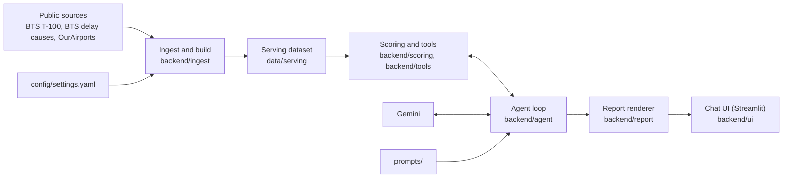

# Airport investment agent: design

## 1. Overview
The agent is a chat tool that helps analysts find US airports where terminal renovation or expansion is likely to pay off. It answers questions such as:

1. Which airports in New England are strong candidates for terminal expansion?
2. Compare LA and Santa Ana airport congestion levels.
3. What is the percentage of long-haul flights out of Anchorage airport?
4. What is the unmet flight demand in SFO airport and why?

The thesis: renovation pays where added capacity would be filled. The passenger side asks whether demand is growing and planes are full; the flight side, whether flights are growing and the airport is congested. The capacity-need score ranks covered US airports on both. It is a proxy for profit, not a financial return.

The language model never computes a number. Every figure comes from deterministic code over a fixed dataset; the model picks tools and writes short prose that quotes the tools' values, and code checks each number before it is shown.

## 2. Architecture

- **Ingest and build** (`backend/ingest/`): fetchers download the raw files. `python -m backend.ingest.build` cleans and joins them and runs checks that stop the build on failure (duplicate keys, named airports present, totals reconcile). It writes the serving folder only if every check passes.
- **Serving dataset** (`data/serving/`): three parquet tables (`airports`, `airport_month`, `routes`), a `manifest.json` (periods, window, coverage, check results) and the settings used for the build. The running app reads only this folder and `prompts/`.
- **Scoring and tools**: pure formulas, the score, the label, robustness, unmet demand and warnings. Five read-only data tools sit on top of them: `resolve_airport`, `rank_airports` (optionally with custom weights), `compare_airports` (2 to 5 airports), `airport_profile` and `airport_trend` (one metric month by month). `faa_airport_status` reads the live FAA airport status feed. Two data-update tools call the public BTS APIs at question time: `check_data_updates` asks whether a newer month exists (about 7 seconds, changes nothing), and `refresh_data` downloads every source and rebuilds the serving data (about 75 seconds; see section 3). Every tool returns the same envelope: result, metric definitions, warnings, per-airport data quality and data periods.
- **Agent loop**: a small hand-written loop around the Gemini API. It runs the tool calls, checks the numbers in the answer and saves the turn.
- **Report**: turns the tool results and the model's prose into a structured answer.
- **Chat UI**: a local, single-user Streamlit app. The sidebar holds conversations (in memory, kept while the server runs) and the sample questions. Each answer shows the report, the tool calls, a number-check badge and follow-up buttons. Input is disabled while a turn runs.
- **Voice**: the chat bar takes a recording. Gemini transcribes it with a vocabulary hint (airport names and codes, metric terms), and the text is asked like a typed question. A Listen button reads an answer's Verdict aloud with the browser's speech synthesis; answers to spoken questions are read automatically. Desktop browsers only.

## 3. Data sources and period
| Source | Access | Used for | Period in this build |
|---|---|---|---|
| BTS T-100 airport-month summary | data.bts.gov API | passengers, seats, departures, freight | 2019-01 to 2026-07 |
| BTS on-time delay causes | TranStats download | arrivals, delays, delay causes, cancellations | 2024-01 to 2026-07 |
| BTS T-100 segment | TranStats download | route distances, flight class | 2025-08 to 2026-07 |
| OurAirports | CSV download | names, locations, runways | current file |

- **Window**: the 12 months ending at the latest month that every source has: **2025-08 to 2026-07**. The prior window is 2024-08 to 2025-07. Growth is measured from 2019, the last full year before 2020.
- **Covered airports**: US airports with scheduled service and at least 250,000 passengers in the window. There are 180 (out of 667 in the data), and 178 of them have delay data.
- **Size tiers** by 12-month passengers: large (10 million or more; 30 airports), medium (3 million; 26), small (1 million; 48) and nonhub (76). Size is for grouping only, not scored.
- **Known gaps**: New Haven (HVN) has no delay rows. Palm Beach is DJT in T-100 but PBI in the other BTS files; there is no crosswalk, so DJT has no delay data or routes. Missing data is reported as unknown, never as zero.
- The data is historical. Answers state the period they use. The one live source is the FAA airport status feed (`nasstatus.faa.gov`), read at question time for current delays and ground stops; it is shown with its update time and never enters the score. Other "live" questions are declined.
- **Refresh**: when the user asks to update the data, `refresh_data` downloads every source into a temporary folder and runs the same build and checks there. The new raw and serving folders replace the old ones only when every check passes and the window moved to a newer month; otherwise the current data stays. Code, not the prompt, allows the call only when the user's words ask to update or refresh the data. Answers given earlier in the conversation keep the old window, and the model says so.

## 4. Scoring methodology

| Side | Component | Raw metric (current window unless stated) | Source | Weight |
|---|---|---|---|---|
| Passenger | passenger growth | compound annual passenger growth since 2019 | T-100 summary | 0.25 |
| Passenger | load factor | passengers / seats | T-100 summary | 0.25 |
| Flight | flight growth | compound annual departures growth since 2019 | T-100 summary | 0.25 |
| Flight | congestion | arrival system-delay (NAS cause) rate | BTS delay causes | 0.25 |

**Score**
- Each raw metric becomes a national rank percentile across the 180 covered airports: `(rank - 1) / (n - 1) * 100`, where rank 1 is the lowest value and ties share the average rank.
- The total score (0 to 100) is the weighted sum of the four percentiles. Equal weights give each side half.
- The passenger score and the flight score are each the mean of their side's two percentiles, and show which kind of capacity is under pressure.
- Rates come from counts summed over the window, not from averages of monthly rates. Weights and every threshold below live in `config/settings.yaml`.

**Partial scores**: missing values are never imputed. An airport missing a component has no total score. Its available components are re-weighted into a labeled partial score, which is never compared with full scores and never labeled. In this build, 178 airports have a full score; DJT and HVN have only a partial score, because without delay data they have no flight side.

**Fixed-rule label** (computed in code; the model only quotes it)
- **Potential**: high at a score of 65 or more, medium from 50, low below 50.
- **Confidence**: high with full data and no warning, medium with a warning (cargo-heavy), low without a full score.
- **Recommendation**:

| Potential | Confidence high | Confidence medium |
|---|---|---|
| High | Prioritize for due diligence | Investigate further |
| Medium | Investigate further | Monitor |
| Low | Deprioritize | Deprioritize |
| Partial score | Not scored: review the available metrics | same |

- **Strengths and weaknesses**: strengths are components at or above the 70th percentile; weaknesses are components below the 40th.

**Robustness**
- Equal weights are a choice, so every score ranking reports how much it depends on them.
- The check draws 500 weight vectors from a Dirichlet distribution centred on the default weights (concentration 20, seed 42). For each draw it re-ranks the fully scored airports in the filter, for example New England.
- The verdict depends on how often an airport stays in the top 3: **robust** in at least 80% of draws, **sensitive** from 20%, **rarely in top** below 20%.

**Custom weights**: a user can re-rank with a different emphasis ("growth counts twice as much"). `rank_airports` takes four optional weights, normalizes them to sum to 1 and re-weights the same percentiles, which do not depend on the weights. The labels use the same thresholds, each airport carries its rank under the default weights so a rank change is never computed by the model, and the robustness draws are centred on the custom weights. The report names the weights and lists the result as a sensitivity check, not the default score.

**Trend**: `airport_trend` gives one airport's passengers, departures, load factor or delay rates month by month (traffic from 2019, delays from 2024-01): each month's value, the same month a year earlier and the change, the highest and lowest month, the last 12 months against the 12 before, and a seasonal profile. Rates come from summed counts; a month without delay data is unknown.

**Context only, never scored**: long-haul share, cargo share, total delay rate, cancellations, departures per usable runway (open runways of at least 3,000 ft) and size tier. The assignment asks about passenger and flight capacity, so other measures stay out of the score.
- **Long-haul share**: the share of departures at or above 2,000, 2,500 and 3,000 miles (3,000 is the default).
  - The headline counts scheduled passenger flights (class F).
  - The share including cargo and charter flights (classes F, G, L, P) is shown beside it; at a cargo hub such as Anchorage the two differ a lot.
- **Unmet demand**: three measures, all lower bounds, because a constrained airport never schedules the flights that would reveal its full demand.
  - The seat gap is the extra seats a year needed to bring the load factor down to 85%. Zero is a measured result, not missing data.
  - Excess delayed flights are the delayed arrivals above what the national median delay rate would give.
  - The delay-cause shares split delays among system, airline, late-arriving aircraft, extreme weather and security.

**Proxies**
- The score stands in for profit, because no public source gives renovation cost, gate counts, terminal utilization or revenue per passenger.
- The NAS delay rate stands in for congestion; NAS also includes ordinary weather.
- Departures include cargo flights. An airport whose cargo classes (G and P) are 30% or more of departures gets a cargo-heavy warning, which lowers its confidence.

## 5. Where and how AI is used
The product uses one model through one adapter, `backend/agent/llm.py`: Gemini `gemini-3.8-flash` by default, which the `GEMINI_MODEL` setting overrides.

**What the model does**
- Chooses the tool and its arguments.
- Resolves place names first. When `resolve_airport` finds several airports, it returns the three largest and the model asks the user which one is meant; the resolver never picks one. When the question asks which of them is biggest, busiest or most delayed, the model compares them instead of asking.
- Asks clarifying questions.
- Checks for newer data, and refreshes it only when asked.
- Transcribes spoken questions.
- Reports live FAA airport status (ground stops, delay programs, delays) with the FAA update time, labelled live and kept apart from the score. "Nothing listed" is reported as no FAA program or reported delay, not as no delays, and closures to private aviation only are never reported as the airport being closed.
- Declines out-of-scope requests (cost or ROI, routes between cities, gate or terminal size, other live data, non-US airports) and offers the closest answer it can give.
- Writes the **Verdict** and **Why** of each data answer, and a **Comparison** before them only for investment questions.
- May add background knowledge only in one sentence that starts with "Background (not from our data):" and contains no numbers.

**What the model never does**
- Compute a number. Differences and ratios between airports come from the tools.
- Assign a label.
- Write tables, warnings, data periods or confidence.

**Checks on the model's text**
- **Number check**: every number must match a value in the conversation's tool results, the tool inputs or the user's text.
  - The match allows for rounding: half of the last written digit, capped at 2.5% for round numbers.
  - Years, ranks, list markers and small whole counts are exempt.
- **Per-airport check**: a number in a sentence that names exactly one airport must be that airport's value, or a value tied to no airport, such as a national median.
- If either check fails, the model gets one rewrite request that lists the bad numbers. If the rewrite still fails, the answer is shown with the unverified numbers flagged. The UI shows passed, rewritten or flagged.

**Limits**: at most 7 model calls with tools per question, then one forced answer without tools; one retry after 5 seconds on a rate limit; a failed model call saves nothing. Each call has a thinking budget of 8,192 tokens inside an output cap of 16,384, so a long reasoning step cannot crowd out the answer.

**Prompts**: `prompts/system.md` holds the role, thirteen rules, the answer format and six placeholder examples; `prompts/knowledge.md` holds metric definitions and data limits. At startup, code appends the scoring rules generated from the settings (so prompt and code cannot disagree) and the data periods from the manifest. Tool results and earlier messages are treated as data, not instructions.

## 6. Assumptions, uncertainty and scope
Every answer that uses data is a report with fixed sections:
- **Written by code**: the airports (details, scores, labels); a question-specific block; robustness (score rankings); warnings; data period, assumptions and confidence; "still needed before investing" (investment questions only); up to three suggested follow-ups.
- **Written by the model**: Comparison, Verdict and Why.

A question that is not about investing (an airport's size, delays, long-haul share or unmet demand) gets a factual report: no scores, labels, strengths or Comparison, so the answer is not buried under the investment screen.

- **Data period** per source, with the prior window and baseline year. **Assumptions** list each metric's proxy note, for example "lower bound of unmet demand".
- **Answer confidence**: low when an airport the answer is about has partial data (outside a ranking); medium when a proxy is used, a ranking includes partial-data airports or the answer uses live FAA status; high otherwise.
- **Warnings**: "no delay data" (high severity; congestion unknown, not zero) and "cargo-heavy" (medium).
- **Still needed before investing**: terminal utilization, construction and operating cost, incremental passengers, revenue per passenger and lease terms, and regulatory and physical constraints, then a line that this is a data screen, not investment advice.
- **Follow-ups** on the same airports get a short form (Verdict, Why, the answering block, one warnings-and-confidence line). An answer that reuses earlier figures says so.

## 7. Key tradeoffs
| Decision | Reason |
|---|---|
| Scoring in code, prose by the model | Numbers are deterministic and repeatable, and every figure in an answer can be checked. |
| Code renders tables and fixed sections; the model writes up to three short parts | Two sources for the same number would eventually disagree. The model does what it is good at: choosing what matters and explaining it. |
| Capacity need as a proxy for profit | No public data on renovation cost, gates or revenue. The proxy is named in the thesis, the definitions and the "still needed" list. |
| Rank percentiles instead of z-scores or min-max scaling | Robust to outliers (a few very large or very congested airports) and comparable across components with different units. |
| Equal weights plus a robustness check, not tuned weights | There is no ground truth to tune against; the verdict shows when a ranking depends on the weighting. |
| No imputation; partial scores never labeled | A guessed congestion value would put an airport in the ranking on invented data. |
| The resolver never picks among several matches | A wrong guess (which Portland?) gives a confident answer about the wrong airport; asking costs one turn. |
| Evals graded by code, not by a model | Repeatable, free, and exact on what matters: airports named, labels, sections, numbers checked. |

## 8. Evaluation
- **Tests** (262, `pytest`, on a small fixture dataset with hand-checked values): formulas, scoring determinism, every label rule and threshold edge, robustness, tools with bad input, the loop with a fake model, the report renderer, graders against deliberately broken reports, the data refresh with fake downloads, the FAA feed parser on a saved real feed, custom weights and the trend with hand-checked values, and the chat backend, voice and UI with a fake agent and a fake transcriber.
- **Independent recompute** (`scripts/recompute/recompute.py`): recomputes the sample-question figures from the raw files without importing project code. An acceptance test compares them with the tools' output.
- **Evals on the real model** (`backend/evals/`): 20 code-graded cases covering the four sample questions, multi-turn follow-ups (including a reload from the session store and a custom-weights re-rank), an ambiguous airport, a "biggest airport" question after a clarification, a newer-data check, live FAA status, a monthly trend, out-of-scope and missing-data questions, and prompt-injection and false-memory probes. Each case checks airports named, required and forbidden content, the number check, report mode and sections, labels against the tool's, no financial claim, and figures against the recompute.
- **Result**: all 20 cases passed in the latest full run (2026-11-09). An earlier run of 16 cases passed 14: `profile_should_expand` added a ranking call, which a tool rule in the prompt fixed, and `background_rule` was cut off when thinking used almost the whole output cap, which the thinking budget fixed.

## 9. Limitations and next steps
**Limitations**
- The score says nothing about cost, financing or return.
- Growth is historical; an airport that just added capacity can look less constrained than it will be.
- NAS delays mix congestion with ordinary weather, and delay data covers the larger airlines' domestic flights only. Slot-limited airports can look less congested than they are.
- T-100 segment data counts a passenger on each leg of a multi-stop trip.
- US airports only; New England is the only named region (other filters are by state and size tier).

**Next steps**: custom weights on comparisons and profiles; forecast-based growth; a composite congestion measure (taxi-out, per-runway load); a code-built fallback answer and fallback models; a larger eval set with repeated runs and a model judge for prose; a scheduled data refresh.
